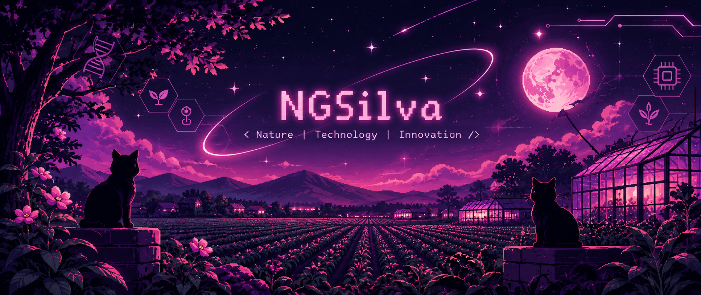

 

  

  
  
  
  

  <i>Exploring the intersection of nature and computation.</i>

 

<h2 align="center">🌸 ABOUT THIS SPACE</h2>

  
  
  

  A space dedicated to exploring ideas, developing software 
  and building technological solutions.

  <b>Focused on the intersection of:</b>

  🧠 Artificial Intelligence & Computer Vision 
  🌱 Agricultural Technology & Smart Monitoring 
  📊 Data Science & Statistical Modeling 
  🔬 Biological Systems & Entomology 
  🛰️ Scientific Computing & Digital Agriculture

---

<h2 align="center">🧬 FEATURED PROJECTS</h2>

<table align="center">
<tr>
<td width="50%" valign="top">

<h3 align="center">01 · ENTOMOTRACK AI</h3>

🔬 Computer Vision & Insect Tracking

Intelligent insect identification and movement tracking through digital microscopy and computer vision.

</td>
<td width="50%" valign="top">

<h3 align="center">02 · MIPIA</h3>

🪲 Intelligent Pest Monitoring

An automated monitoring system for the cotton boll weevil using electronic traps, image acquisition and artificial intelligence.

</td>
</tr>
<tr>
<td width="50%" valign="top">

<h3 align="center">03 · CEAGESP ANALYTICS</h3>

📊 Agricultural Data Intelligence

Statistical analysis, agricultural price monitoring and meteorological data visualization.

<a href="https://nicol-le.github.io/Ceagesp/">VIEW PROJECT ↗</a>

</td>
<td width="50%" valign="top">

<h3 align="center">04 · AGRICULTURAL DIGITAL TWIN</h3>

🌱 Computational Agriculture

A computational framework for exploring crop development, environmental conditions and agricultural management scenarios.

</td>
</tr>
</table>

---

<h2 align="center">💻 TECHNOLOGY STACK</h2>

  

  
  
  
  
  

---

<h2 align="center">📈 GITHUB ANALYTICS</h2>

  
  

  

  

---

<h2 align="center">🌙 RESEARCH ARCHIVE</h2>

  Previous experiments, developments and repositories.

  

---

<h2 align="center">✨ FINAL TRANSMISSION</h2>

  <i>Nature has its own algorithms. 
  We are learning to understand them.</i>

  

